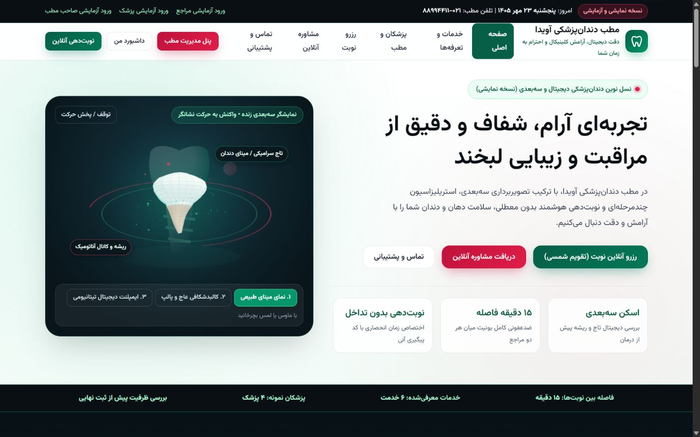

# Avida Dental Clinic — Python & SQLite

A Persian, right-to-left dental-clinic portfolio demo with appointment booking, patient accounts, consultation threads and an administration panel. Its backend uses **Python's standard library and SQLite**; the frontend uses plain HTML, CSS and JavaScript with a locally bundled Vazirmatn font.

This repository contains the reviewed **Python edition** of the project. It is a local demonstration of application flows, not an operating clinic or a production medical-record system. Clinic details, identities, appointments, messages, telephone numbers and prices in the seed data are synthetic examples.



## Features

- Nine application views: home, services, doctors, booking, consultation, contact, authentication, patient dashboard and administration.
- Persian typography, RTL layout, responsive controls and a Jalali appointment calendar.
- Step-by-step booking with saved selections, login-and-return flow and tracking codes.
- Server-side availability checks using service duration, buffer time, doctor schedules, blocked intervals and existing appointments.
- SQLite write transactions for booking conflicts, appointment cancellation and rescheduling, including availability that excludes the appointment being moved.
- Role-based access for the patient, doctor and administrator, with session expiry and password recovery in explicit demo mode.
- Persistent consultation/support conversations and editable clinic, service, doctor and scheduling information.
- Procedural tooth illustrations and interactive motion rendered with Canvas 2D, plus a before/after comparison slider and reduced-motion handling.
- Keyboard-accessible navigation and rescheduling dialog, with automated regressions for routing, forms and state handling.

The local animation helper exposes a small GSAP-style API; it is not the full official GSAP library. Runtime assets are served locally and require no CDN.

## Run locally

**Requirements:** Python 3.12 or newer. Node.js 22 is needed only to run the frontend regression tests. No `pip install` or `npm install` is required.

From the project directory:

```sh
python -X utf8 server.py 8080
```

On Windows, you can also double-click `Start-Avida.cmd`.

Open [http://127.0.0.1:8080](http://127.0.0.1:8080). The server binds to the loopback interface. Press `Ctrl+C` in its terminal to stop it.

The repository ships **no database**. First startup creates the SQLite files in `data/` and initializes the synthetic demo dataset from `server.py`. Later starts preserve local changes. Database files are excluded from version control.

## Demo accounts

These credentials are deliberately public and exist only for local evaluation. The header also provides demo-login buttons.

| Role | Email | Demo password |
| --- | --- | --- |
| Administrator | `admin@avidadental.ir` | `AvidaAdmin@1405` |
| Doctor | `dr.farahmand@avidadental.ir` | `AvidaDoc@1405` |
| Patient | `sara.moradi@example.ir` | `AvidaUser@1405` |

Use synthetic information when trying the forms. Authentication and final appointment creation require the running HTTP server.

## Tests

Run from the repository root:

```sh
python -X utf8 -m unittest discover -s tests -v
node tests/test_frontend.cjs
```

The suite contains **12 backend HTTP/SQLite regressions** and **18 frontend regressions**. Backend tests create temporary, isolated databases and start an ephemeral loopback server. Frontend tests use Node's built-in modules and a controlled DOM/API harness; they are not a substitute for browser or accessibility certification.

Coverage includes booking conflicts, invalid dates, expired sessions, recovery-token expiry, access control, guest-data isolation, rescheduling, validation, deep-link navigation, duplicate submissions, stale responses and animation cleanup. The included GitHub Actions workflow is configured to run the same commands with Python 3.12 and Node.js 22; no hosted CI result or deployment is claimed. See [local validation](VALIDATION.md) for the actual results and their scope.

## Project structure

```text
server.py                 Standard-library HTTP server, API, schema and seed data
static/css/               Responsive RTL styles
static/js/                Router, forms, preview and canvas/animation helpers
static/fonts/             Vazirmatn font, OFL license and source provenance
static/*.html             HTTP page templates
*.html                    Standalone public-preview entry points
tests/                    Python and Node regression suites
data/.gitkeep             Empty runtime-data directory; databases stay local
docs/images/desktop.jpg   Reviewed desktop screenshot
```

## Scope and limitations

- SMS and email delivery are not connected. Password recovery displays a demo code instead of sending one.
- Opening HTML directly with `file://` offers a read-only public preview. Account, booking and persistence operations require the local HTTP server.
- The server is intended for local evaluation. This repository does not provide a hosted deployment, HTTPS, a production backup/restore workflow, compliance certification or an independent security/accessibility audit.
- Demo identities, clinic contact details, prices and treatment illustrations must not be presented as verified real-world clinical information or patient outcomes.

## Source and font notices

The starting project was supplied as `avida_dental_clinic_pro_multipage.zip` and was reviewed with AI assistance. This edition includes fixes to Windows execution, booking/session behavior, navigation, form state, keyboard interaction and typography. The unrelated Java backend and unverified design-reference notes from the original bundle are not included in this Python repository.

No project-wide software license has been selected. The included **Vazirmatn v33.003** font retains its **SIL Open Font License 1.1** and upstream copyright notice; see [font license](static/fonts/LICENSE-Vazirmatn.txt) and [source/hash provenance](static/fonts/README-Vazirmatn.txt).

---

## راهنمای فارسی

«مطب دندان‌پزشکی آویدا» یک پروژه نمایشی فارسی و راست‌به‌چپ برای نمونه‌کار است. این نسخه با Python و SQLite اجرا می‌شود و برای اجرای سایت به نصب کتابخانه خارجی یا Node.js نیاز ندارد. اطلاعات مطب، پزشکان، مراجعان، پیام‌ها و هزینه‌ها همگی داده نمونه‌اند.

برای اجرا در پوشه پروژه دستور زیر را وارد کنید یا در ویندوز `Start-Avida.cmd` را باز کنید:

```powershell
python -X utf8 server.py 8080
```

سپس [نشانی محلی سایت](http://127.0.0.1:8080) را باز کنید. پایگاه داده در اولین اجرا از روی داده نمونه داخل کد ساخته می‌شود؛ هیچ فایل پایگاه داده‌ای در مخزن قرار ندارد. جدول حساب‌های آزمایشی در بالا آمده است.

امکانات شامل رزرو مرحله‌ای با تقویم شمسی، بررسی ظرفیت و جلوگیری از تداخل، لغو و جابه‌جایی نوبت، داشبورد مراجع، مشاوره و پشتیبانی، پنل مدیریت و مدل تعاملی دندان است. رابط از فونت محلی وزیرمتن استفاده می‌کند.

برای آزمون، دو دستور بخش Tests را اجرا کنید: ۱۲ آزمون بک‌اند با پایگاه داده موقت و ۱۸ آزمون فرانت‌اند. ارسال واقعی پیامک و ایمیل متصل نیست؛ بازیابی رمز آزمایشی است. بازکردن مستقیم HTML فقط پیش‌نمایش خواندنی است و ثبت نوبت و ذخیره تغییرات به سرور محلی نیاز دارد. این پروژه سامانه درمانی آماده بهره‌برداری عمومی نیست.
